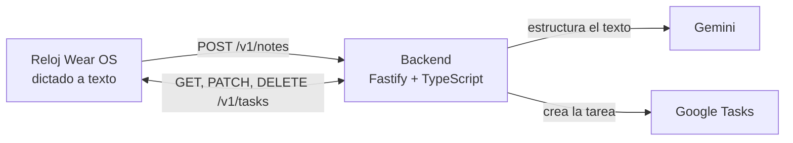
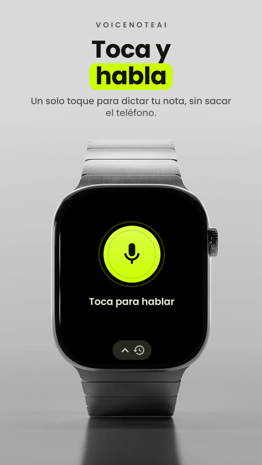
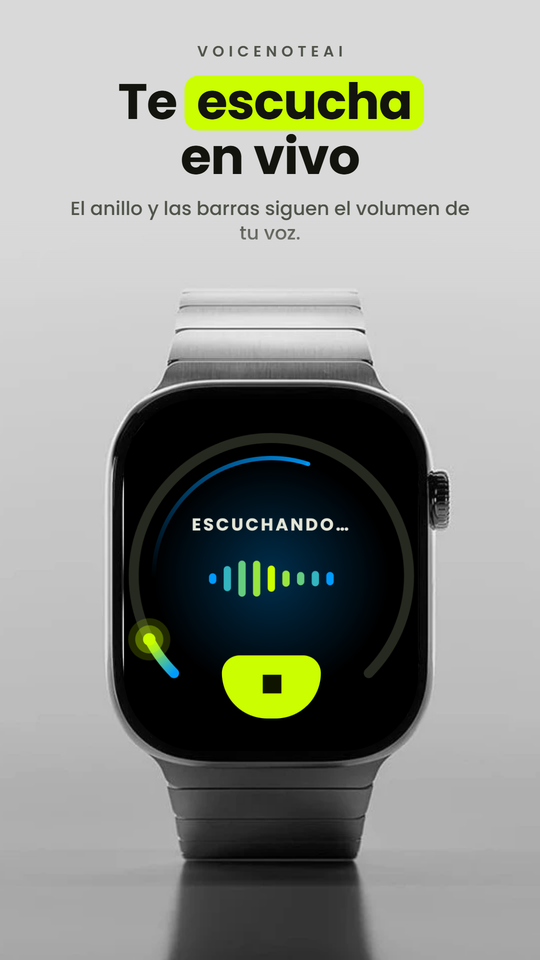
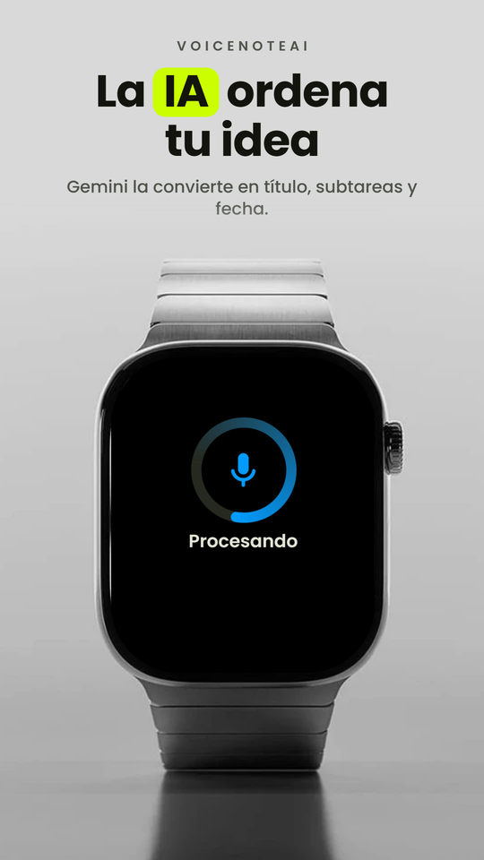
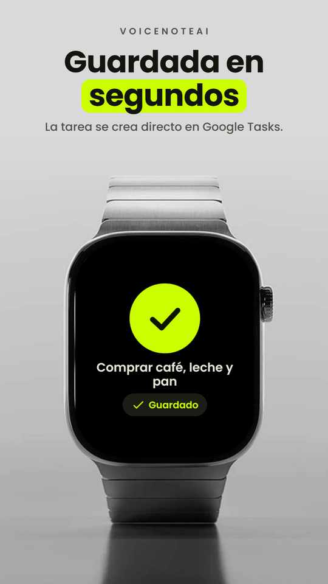
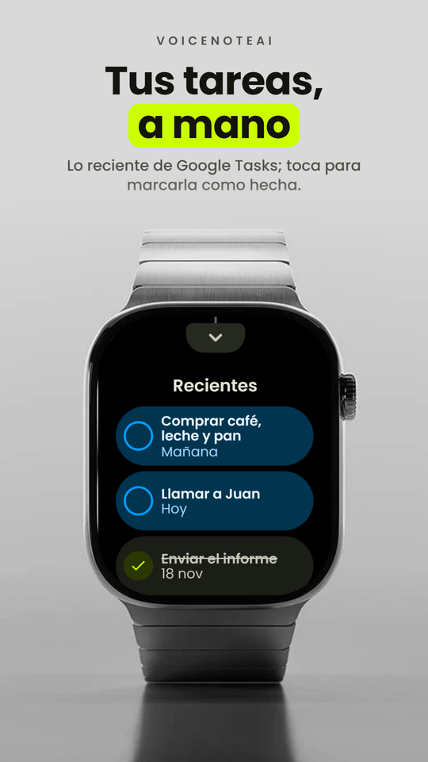
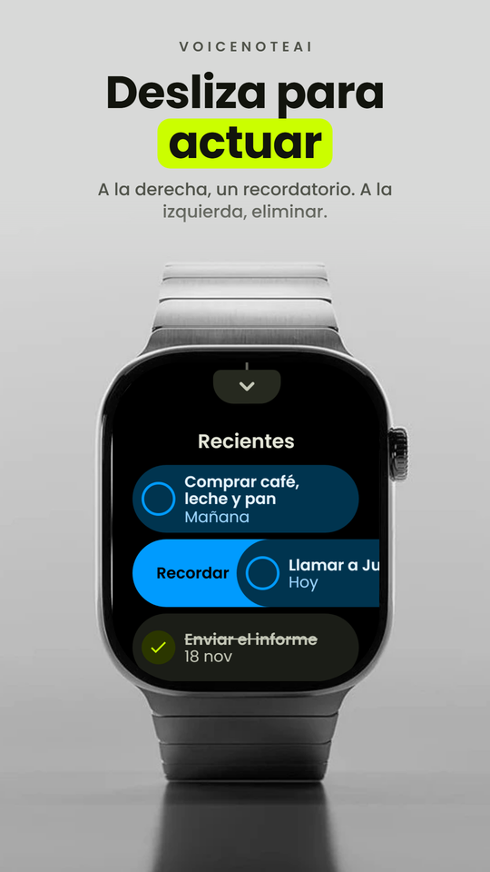
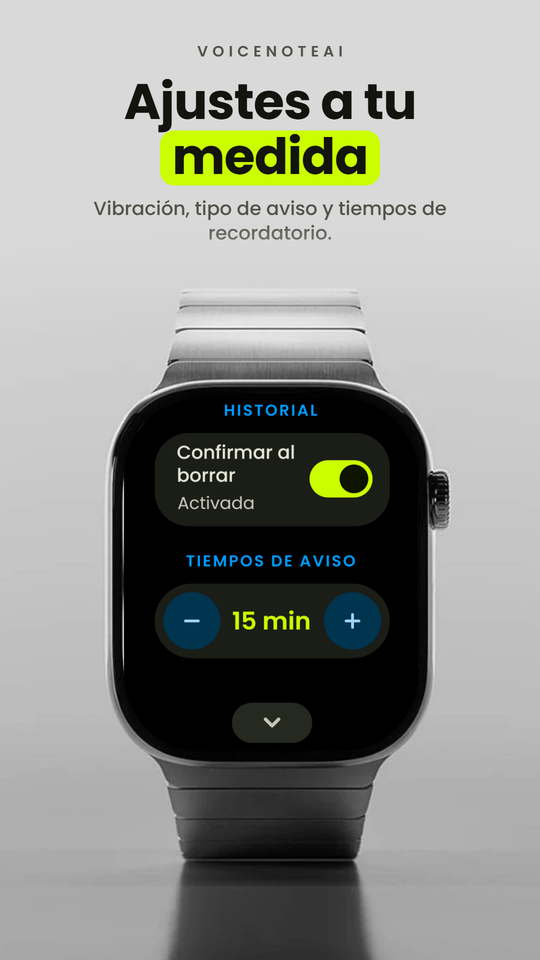
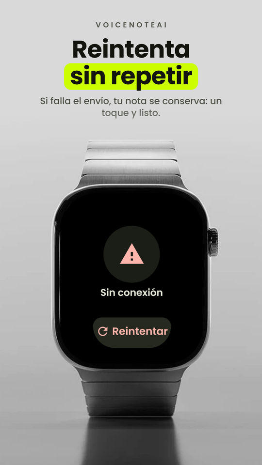

<div align="center">


# VoiceNoteAI

**Levantas la muñeca, hablas y tu nota queda como tarea en Google Tasks.**

App para **Wear OS** que convierte un dictado libre en una tarea con título, subtareas y fecha,
gracias a un backend propio y a la IA de Gemini.

-4285F4?style=flat-square&logo=wearos&logoColor=white)


[Inicio rápido](#-inicio-rápido) ·
[Configuración](#-configuración) ·
[API](#-api) ·
[Estructura](#-estructura-del-proyecto) ·
[Problemas frecuentes](#-problemas-frecuentes) ·
[Contribuir](#-contribuir)

</div>

---

## ✨ Qué hace

Anotar algo desde el reloj suele obligar a sacar el teléfono, o a dictar en apps que guardan el texto tal cual, sin
orden. VoiceNoteAI toma un dictado como *«mañana comprar café, leche y pan»* y crea en Google Tasks una tarea
**«Comprar café, leche y pan»** con sus subtareas y la fecha de mañana.



> 🔒 **La app nunca graba, guarda ni envía audio.** El reconocedor de voz del propio reloj produce el texto y solo ese
> texto viaja al backend. La definición completa del producto está en [`docs/PRD.md`](docs/PRD.md).

## 📱 Pantallas

<table>
  <tr>
    <td align="center"><br><sub><b>Inicio</b></sub></td>
    <td align="center"><br><sub><b>Escuchando</b></sub></td>
    <td align="center"><br><sub><b>Procesando</b></sub></td>
    <td align="center"><br><sub><b>Guardado</b></sub></td>
  </tr>
  <tr>
    <td align="center"><br><sub><b>Historial</b></sub></td>
    <td align="center"><br><sub><b>Deslizar una tarea</b></sub></td>
    <td align="center"><br><sub><b>Ajustes</b></sub></td>
    <td align="center"><br><sub><b>Error y reintento</b></sub></td>
  </tr>
</table>

<sub>Imágenes generadas a partir del diseño «Volt» de la app sobre un mockup de reloj; no son capturas de un dispositivo.
La maqueta de diseño está en [`docs/mockup_smartwatch_volt.html`](docs/mockup_smartwatch_volt.html).</sub>

## 🎯 Características

**Reloj (Wear OS)**
- **Dictado por voz** con el reconocedor del dispositivo (`SpeechRecognizer`, español `es-CO`), con un anillo que sigue
  el volumen real de la voz y un tope de 60 s. Si el reloj no trae servicio de reconocimiento, usa la pantalla de
  dictado del sistema.
- **Cinco estados** con color, icono y vibración propios, para entenderlos sin leer: inicial, escuchando, procesando,
  guardado y error. Los errores traen una acción clara en el mismo botón (reintentar sin volver a hablar, abrir
  ajustes o volver).
- **Historial**: desliza hacia arriba y verás las tareas recientes de Google Tasks, incluidas las creadas desde el
  teléfono. Toca una para marcarla hecha o pendiente.
- **Gestos sobre cada tarea**: a la derecha, **Recordar** (un aviso local en el reloj); a la izquierda, **Eliminar**,
  con confirmación «¿Eliminar tarea?» activada de fábrica.
- **Ajustes** (desliza hacia abajo): vibración, tipo de aviso (sonido y vibración, solo vibrar o silencio),
  confirmación al borrar y tiempo del recordatorio, de 1 a 60 min.
- **Calentamiento del servidor** al abrir la app, para que el primer envío no espere al arranque en frío de Render.
- Diseño propio **«Volt»**: fondo negro OLED, verde `#cbfe00` y azul `#009bfe`, tipografía Poppins, Material 3 Expressive.

**Backend**
- Estructura el texto con **Gemini**: título, texto limpio, subtareas y fecha relativa resuelta («mañana», «el viernes»).
- Si la IA falla o tarda demasiado, **la nota se guarda igualmente sin estructurar**: no se pierde nada.
- Lee, marca y elimina tareas del historial. Las tareas vencidas se ocultan del reloj, pero siguen intactas en Google Tasks.
- Autenticación con token Bearer, errores tipados y especificación OpenAPI en `GET /openapi.json`.
- Sin base de datos: el único estado persistente son las tareas en Google Tasks.

## 🧰 Tecnologías

| Parte | Tecnologías |
|---|---|
| App del reloj | Kotlin 2.2, Jetpack Compose para Wear OS (Material 3 `1.5.6`), Ktor Client 3, kotlinx.serialization, Coroutines, R8 |
| Backend | TypeScript, Node.js 22+, Fastify 5, `@google/genai`, `@googleapis/tasks`, Vitest |
| Servicios | Google Tasks API, Google OAuth 2.0, Gemini API (Google AI Studio) |
| Infraestructura | Render (plan gratuito, [`render.yaml`](render.yaml)) |
| Build | Gradle 9.8, Android Gradle Plugin 9.4 |

## 🚀 Inicio rápido

### Requisitos

| Software | Versión |
|---|---|
| Android Studio | Reciente, con **Android SDK Platform 37** y *platform-tools* (ADB) |
| JDK | 25. No hace falta instalarlo: Gradle lo descarga la primera vez |
| Node.js | 22 o superior (solo para el backend) |
| Reloj Wear OS | Wear OS 3+ (API 30+) **físico y con micrófono** para dictar. Un emulador sirve para ver la interfaz |
| Cuentas | Google Cloud y Google AI Studio (solo para el backend) |

> Los emuladores de Wear OS **no** traen reconocedor de voz: sirven para revisar la interfaz y la navegación, no para dictar.

### 1. Clona el repositorio

```sh
git clone https://github.com/ingmao021/VoiceNoteAI.git
cd VoiceNoteAI
```

### 2. Elige cómo probarlo

**A. Solo la interfaz (2 minutos, sin cuentas ni backend).** Abre la raíz del repositorio en Android Studio
(**File → Open**), crea un emulador de Wear OS y ejecuta el módulo `:wear`, o desde la terminal:

```sh
./gradlew :wear:installDebug      # en PowerShell: .\gradlew :wear:installDebug
```

Sin `voicenoteai.devApiToken` la app no envía nada: muestra el texto dictado como título y el historial avisa de que
no está configurado.

**B. Todo funcionando (voz → IA → Google Tasks).** Necesitas el backend, las credenciales de Google y un reloj físico:

1. Configura Google Cloud y Gemini: [Configuración](#-configuración).
2. Arranca el backend:
   ```sh
   cd backend
   npm install
   cp .env.example .env      # rellénalo según «Configuración»
   npm run refresh-token     # una sola vez: imprime GOOGLE_REFRESH_TOKEN para .env
   npm run dev               # http://localhost:3000
   ```
3. Crea `local.properties` en la raíz con el mismo token del backend (ver abajo) y ejecuta la app en el reloj.

## 🔧 Configuración

### Google Cloud (una sola vez)

1. En [Google Cloud Console](https://console.cloud.google.com/), crea un proyecto y habilita **Google Tasks API**.
2. Configura la **pantalla de consentimiento de OAuth** en modo *Testing* y añade tu cuenta como usuario de prueba.
3. Crea un **ID de cliente OAuth** de tipo **Aplicación web** con esta URI de redirección autorizada:
   `http://localhost:3000/auth/google/callback`
4. Copia el ID y el secreto del cliente a `backend/.env`. Con el backend apagado, ejecuta `npm run refresh-token`,
   abre la URL que imprime, acepta los permisos y copia el `GOOGLE_REFRESH_TOKEN` resultante a `.env`.
5. En [Google AI Studio](https://aistudio.google.com/) crea una clave de API para Gemini.

### Variables de `backend/.env`

Parte de [`backend/.env.example`](backend/.env.example). El backend **no arranca** si falta alguna obligatoria.

| Variable | ¿Obligatoria? | Por defecto | Descripción |
|---|:---:|---|---|
| `DEV_API_TOKEN` | Sí | | Token compartido con el reloj. Genéralo con `node -e "console.log(crypto.randomBytes(32).toString('base64url'))"` |
| `GOOGLE_CLIENT_ID` | Sí | | ID del cliente OAuth |
| `GOOGLE_CLIENT_SECRET` | Sí | | Secreto del cliente OAuth |
| `GOOGLE_REFRESH_TOKEN` | Sí | | Lo imprime `npm run refresh-token` |
| `GEMINI_API_KEY` | No | | Sin clave, las notas se guardan sin estructurar |
| `GEMINI_MODEL` | No | `gemini-3.5-flash-lite` | Modelo de Gemini |
| `TIME_ZONE` | No | `America/Bogota` | Zona con la que se resuelven «mañana», «el viernes»… |
| `PORT` | No | `3000` | Puerto HTTP |

`.env` nunca se sube al repositorio.

### `local.properties` (raíz del repositorio)

Android Studio ya añade `sdk.dir`. El archivo no se versiona.

```properties
# El mismo valor que DEV_API_TOKEN del backend. Sin él, la app no envía nada.
voicenoteai.devApiToken=el-mismo-token-del-backend
# Desarrollo local con `npm run dev`: 10.0.2.2 es el PC visto desde el emulador (valor por defecto).
voicenoteai.backendUrl=http://10.0.2.2:3000
# Contra un backend desplegado, usa su URL HTTPS:
# voicenoteai.backendUrl=https://tu-servicio.onrender.com

# Opcional: firma de release. Sin estas líneas se firma con la clave de debug.
# voicenoteai.keystore.path=keystore/voicenoteai.jks
# voicenoteai.keystore.password=...
# voicenoteai.keystore.alias=voicenoteai
# voicenoteai.keystore.keyPassword=...
```

La build de **debug** permite HTTP sin cifrar solo hacia `10.0.2.2` y `localhost`; la de **release** exige HTTPS.
El token se compila dentro de la app: tras cambiar `local.properties`, vuelve a instalarla.

### Desplegar en Render (opcional)

[`render.yaml`](render.yaml) describe el servicio: plan gratuito, rama `main`, raíz `backend/`. Los secretos
(`DEV_API_TOKEN`, `GOOGLE_*`, `GEMINI_API_KEY`) se rellenan en el panel de Render, nunca en el repositorio. El plan
gratuito duerme el servicio tras 15 min sin tráfico; la app lo despierta con `GET /v1/health` al abrirse.

## 💻 Ejecución

### Backend

```sh
cd backend
npm run dev          # desarrollo con recarga: http://localhost:3000
npm test             # pruebas (Vitest, sin red)
npm run typecheck    # tipos
npm run build        # compila a dist/
npm start            # producción (lo que ejecuta Render)
```

### App en el emulador

```sh
./gradlew :wear:installDebug
```

### App en un reloj físico

Usa la build **release**: está optimizada con R8 (~2,4 MB) y solo habla por HTTPS, así que `voicenoteai.backendUrl`
debe apuntar a un backend desplegado.

1. En el reloj, entra en **Ajustes → Sistema → Acerca de → Versiones** y toca **Número de compilación** 7 veces.
   Después, en **Ajustes → Opciones para desarrolladores**, activa **Depuración por ADB** y **Depuración inalámbrica**.
   El reloj y el PC deben estar en la misma red Wi-Fi.
2. Empareja y conecta (`adb` está en `%LOCALAPPDATA%\Android\Sdk\platform-tools` en Windows):
   ```sh
   adb pair <ip>:<puerto-de-emparejamiento>   # pantalla «Vincular dispositivo nuevo»; pide el código
   adb connect <ip>:<puerto>                  # pantalla principal de «Depuración inalámbrica»
   ```
3. Instala y abre la app:
   ```sh
   ./gradlew :wear:installRelease
   adb shell monkey -p com.voicenoteai.wear -c android.intent.category.LAUNCHER 1
   ```
4. El primer toque pide permiso para usar el micrófono. Si lo niegas para siempre, la pantalla de error ofrece
   **TOCA PARA ABRIR AJUSTES**.

### Pruebas de la app

```sh
./gradlew :wear:testDebugUnitTest   # pruebas unitarias
./gradlew :wear:lintDebug           # lint de Android
```

## 👆 Uso en el reloj

1. Abre **VoiceNoteAI** y toca el botón del micrófono.
2. Di la nota, por ejemplo: *«Mañana comprar café, leche y pan»*. El anillo sigue tu voz.
3. Toca el botón verde de parar para terminar (o espera a que dejes de hablar).
4. Mientras se procesa, verás el indicador de progreso. Al terminar, el reloj vibra y muestra el título de la tarea creada.

La tarea aparece en Google Tasks con título, notas, subtareas («café», «leche», «pan») y fecha de vencimiento.

| Gesto | Dónde | Qué hace |
|---|---|---|
| Deslizar hacia arriba | Pantalla inicial | Abre el **historial** |
| Deslizar hacia abajo | Pantalla inicial | Abre los **ajustes** |
| Tocar una tarea | Historial | La marca como hecha o pendiente |
| Deslizar una tarea a la derecha | Historial | **Recordar**: programa un aviso local en el reloj |
| Deslizar una tarea a la izquierda | Historial | **Eliminar** (pide confirmación salvo que la apagues en Ajustes) |
| Tocar el asa de la cabecera, o el gesto de retroceso | Historial y ajustes | Vuelve a la nota |

## 🔌 API

Todas las rutas salvo `GET /v1/health` exigen `Authorization: Bearer <DEV_API_TOKEN>`. Los ejemplos usan el backend
local; la especificación completa está en `GET /openapi.json`.

```sh
API=http://localhost:3000
```

| Método y ruta | Descripción |
|---|---|
| `GET /v1/health` | Ping de calentamiento. No requiere token |
| `POST /v1/notes` | Estructura el texto con Gemini y crea la tarea (hasta 5000 caracteres) |
| `GET /v1/tasks?limit=20` | Tareas recientes del listado principal, sin las vencidas. `limit` admite 1–50 |
| `PATCH /v1/tasks/:id` | Marca o desmarca una tarea. El cuerpo solo admite `completed` |
| `DELETE /v1/tasks/:id` | Elimina una tarea |

**Crear una nota**

```sh
curl -X POST $API/v1/notes \
  -H "Authorization: Bearer $DEV_API_TOKEN" \
  -H "Content-Type: application/json" \
  -d '{"text": "mañana comprar café, leche y pan"}'
```

```json
{ "id": "MTIzNDU2Nzg5", "title": "Comprar café, leche y pan", "structured": true, "dueDate": "2026-10-15" }
```

`structured` vale `false` cuando la IA falló y se guardó el texto tal cual. `dueDate` es `null` si el dictado no
indicaba fecha.

**Listar, marcar y eliminar**

```sh
curl "$API/v1/tasks?limit=20" -H "Authorization: Bearer $DEV_API_TOKEN"

curl -X PATCH $API/v1/tasks/MTIzNDU2Nzg5 \
  -H "Authorization: Bearer $DEV_API_TOKEN" \
  -H "Content-Type: application/json" \
  -d '{"completed": true}'

curl -X DELETE $API/v1/tasks/MTIzNDU2Nzg5 -H "Authorization: Bearer $DEV_API_TOKEN"
```

```json
{
  "today": "2026-11-07",
  "tasks": [
    { "id": "MTIzNDU2Nzg5", "title": "Comprar café", "dueDate": "2026-11-08", "completed": false }
  ]
}
```

`today` es el día en la zona configurada: el reloj lo usa para etiquetar HOY y MAÑANA igual que el backend.

**Errores**

| Código | `error` | Significado |
|---|---|---|
| 400 | `invalid_request` | Cuerpo mal formado |
| 401 | `invalid_token` | Falta el token o no coincide |
| 404 | `task_not_found` | La tarea ya no existe (`PATCH` y `DELETE`) |
| 422 | `text_empty` / `text_too_long` | Texto vacío o con más de 5000 caracteres |
| 424 | `google_access_revoked` | Hay que volver a autorizar la cuenta de Google |
| 502 | `tasks_provider_error` | Google Tasks rechazó la petición |

## 📁 Estructura del proyecto

```
VoiceNoteAI/
├── wear/                          App Wear OS (módulo Gradle :wear)
│   ├── src/main/java/com/voicenoteai/wear/
│   │   ├── domain/                Modelos, casos de uso e interfaces (sin Android)
│   │   ├── data/                  Voz, cliente HTTP (Ktor), recordatorios, ajustes, batería
│   │   ├── presentation/          Nota, historial, ajustes, ViewModels y tema (Compose)
│   │   └── di/AppContainer.kt     Inyección de dependencias manual
│   ├── src/main/res/              Textos, fuentes (Poppins) e icono
│   ├── src/debug/                 Permite HTTP local solo en debug
│   ├── src/test/                  Pruebas unitarias
│   ├── src/androidTest/           Pruebas de interfaz (requieren dispositivo o emulador)
│   └── src/source/icon/           Imágenes originales del icono de la app
├── backend/                       Servicio Fastify (TypeScript)
│   ├── src/domain/                Nota, fecha de vencimiento, errores de negocio
│   ├── src/application/           Casos de uso (crear nota, historial) y puertos
│   ├── src/infrastructure/        Gemini, Google Tasks, configuración
│   ├── src/presentation/http/     Rutas, esquemas, autenticación y mapeo de errores
│   ├── src/main/                  Arranque y composición
│   ├── scripts/                   Obtención del refresh token de Google
│   └── test/                      Pruebas (Vitest)
├── docs/
│   ├── PRD.md                     Definición del producto
│   ├── mockup_smartwatch_volt.html  Maqueta del diseño «Volt»
│   ├── propuesta_diseño.png       Diseño de referencia
│   └── readme/                    Imágenes de este README
├── .claude/skills/                Guía de diseño para asistentes de código
├── render.yaml                    Despliegue del backend en Render
└── settings.gradle.kts, gradle/   Build de Gradle (raíz)
```

Tanto la app como el backend siguen una arquitectura por capas: el dominio no depende de frameworks y la
infraestructura se conecta en un único punto de composición.

## 🩺 Problemas frecuentes

| Síntoma | Causa y solución |
|---|---|
| El backend no arranca y dice `Missing environment variables` | Falta rellenar variables obligatorias en `backend/.env` (ver la tabla de arriba) |
| `401 invalid_token` | `DEV_API_TOKEN` del backend y `voicenoteai.devApiToken` de `local.properties` no coinciden. Vuelve a instalar la app tras cambiarlo |
| La app no envía nada y el historial dice que no está configurado | Falta `voicenoteai.devApiToken` en `local.properties` |
| `424 google_access_revoked` | La autorización de Google caducó o se revocó: ejecuta de nuevo `npm run refresh-token` y actualiza `GOOGLE_REFRESH_TOKEN` |
| El emulador no reconoce la voz | Los emuladores de Wear OS no traen reconocedor: usa un reloj físico |
| La build release no conecta con `http://…` | Release exige HTTPS. HTTP solo se permite en debug, hacia `10.0.2.2` y `localhost` |
| El primer envío tarda | En el plan gratuito de Render el servicio duerme tras 15 min sin tráfico; la app lo despierta al abrirse |
| La instalación falla al cambiar entre builds | Están firmadas con claves distintas: ejecuta antes `adb uninstall com.voicenoteai.wear` |

## 🤝 Contribuir

1. Crea una rama desde `develop`: `feature/<descripción>` o `fix/<descripción>`. `main` es la rama por defecto y la de
   producción: Render despliega el backend desde ella. Solo recibe versiones estables, fusionando `develop`.
2. Escribe los mensajes de commit con [Conventional Commits](https://www.conventionalcommits.org/es/):
   `feat(wear): …`, `fix(backend): …`, `test: …`, `docs: …`.
3. Antes de abrir el pull request, ejecuta las comprobaciones:
   ```sh
   ./gradlew :wear:testDebugUnitTest :wear:lintDebug
   cd backend && npm run typecheck && npm test
   ```
4. Abre el pull request hacia `develop` con una descripción del cambio y, si toca la interfaz, capturas.
5. Normas del código:
   - Comentarios en español, que expliquen el *porqué*.
   - Sin código muerto ni registros de depuración.
   - Los cambios de interfaz siguen la guía [`.claude/skills/smartwatch-app-design/SKILL.md`](.claude/skills/smartwatch-app-design/SKILL.md) (composición, paleta y accesibilidad).
   - Los secretos nunca se suben al repositorio: van en `.env`, `local.properties` o el panel de Render.

## 📄 Licencia

Este proyecto **no tiene todavía una licencia de código abierto**: todos los derechos están reservados al autor.
Para usarlo, modificarlo o distribuirlo, hay que pedir permiso.

La tipografía **Poppins** incluida en `wear/src/main/res/font/` se distribuye bajo la
[SIL Open Font License 1.1](https://openfontlicense.org/).

## 👤 Autor y contacto

**Anderson**

- GitHub: [@ingmao021](https://github.com/ingmao021)
- Repositorio: [github.com/ingmao021/VoiceNoteAI](https://github.com/ingmao021/VoiceNoteAI)
- Backend de demostración desplegado: [voicenoteai-backend.onrender.com/v1/health](https://voicenoteai-backend.onrender.com/v1/health)
