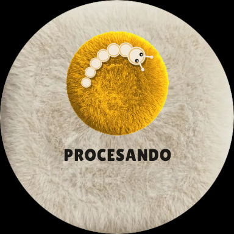

# VoiceNoteAI

Aplicación para reloj inteligente **Wear OS** que captura notas por voz, las estructura con IA y las guarda
como tareas en **Google Tasks**.

**Objetivo:** pasar de una idea a una tarea guardada en segundos, sin sacar el teléfono: levantas la muñeca, tocas,
hablas y listo.

**Problema que resuelve:** anotar algo desde el reloj suele obligar a abrir el teléfono o a dictar en apps que
guardan el texto tal cual, sin orden. VoiceNoteAI convierte un dictado libre («mañana comprar café y llamar a
Juan») en una tarea con título, texto limpio, subtareas y fecha de vencimiento.

La app **nunca graba, guarda ni envía audio**: el reconocedor de voz del propio reloj produce el texto y solo ese
texto viaja al backend. La definición completa del producto está en [`docs/PRD.md`](docs/PRD.md).

---

## Contenido

1. [Características](#características)
2. [Tecnologías](#tecnologías)
3. [Requisitos previos](#requisitos-previos)
4. [Instalación](#instalación)
5. [Configuración](#configuración)
6. [Ejecución](#ejecución)
7. [Uso](#uso)
8. [Estructura del proyecto](#estructura-del-proyecto)
9. [Contribución](#contribución)
10. [Licencia](#licencia)
11. [Autor y contacto](#autor-y-contacto)

---

## Características

**Reloj (Wear OS)**
- Captura por voz con el reconocedor del dispositivo (`SpeechRecognizer`, español `es-CO`), con un anillo que
  sigue el volumen real de la voz y un tope de 60 s.
- Una sola pantalla con cinco estados: **inicial**, **escuchando**, **procesando** (con un gusanito animado),
  **guardado** y **error**. Cada estado tiene su color, icono y vibración propios, para entenderlo sin leer.
- Errores con una acción clara en el mismo botón: reintentar sin volver a hablar, abrir ajustes o volver.
- Respaldo con la pantalla de dictado del sistema en dispositivos sin servicio de reconocimiento.
- Calentamiento del servidor al abrir la app, para que el primer envío no espere al arranque en frío.
- Diseño de felpa propio (fondo crema, parches de color, tipografía Lilita One), pensado para pantallas redondas.

**Backend**
- `POST /v1/notes`: estructura el texto con **Gemini** (título, texto limpio, subtareas y fecha relativa
  resuelta: «mañana», «el viernes»…) y crea la tarea en Google Tasks.
- Si la IA falla o tarda demasiado, la nota se guarda igualmente sin estructurar; no se pierde nada.
- Autenticación con token Bearer, errores tipados y especificación OpenAPI en `/openapi.json`.

## Tecnologías

| Parte | Tecnologías |
|---|---|
| App del reloj | Kotlin 2.2, Jetpack Compose para Wear OS (Material 3 `1.5.6`), Ktor Client 3, kotlinx.serialization, Coroutines, R8 |
| Backend | TypeScript, Node.js 22+, Fastify 5, `@google/genai` (Gemini), `@googleapis/tasks`, Vitest |
| Servicios | Google Tasks API, Google OAuth 2.0, Gemini API (Google AI Studio) |
| Infraestructura | Render (plan gratuito, `render.yaml`), GitHub |
| Herramientas | Android Studio, Gradle 9.8 (JDK 25 vía toolchain), ADB, Python + Pillow (recursos gráficos) |

No hay base de datos: el único estado persistente son las tareas en Google Tasks. La vinculación de cuentas con
PostgreSQL está prevista para una etapa posterior (PRD §12).

## Requisitos previos

| Software | Versión |
|---|---|
| Android Studio | Reciente, con Android SDK 37 y *platform-tools* (ADB) |
| JDK | 25 (Gradle lo descarga solo si no está) |
| Node.js | 22 o superior |
| Reloj Wear OS | Wear OS 3+ (API 30+), **físico** y con micrófono |
| Cuenta de Google | Con acceso a Google Cloud Console y Google AI Studio |

> Los emuladores de Wear OS **no** traen reconocedor de voz. Sirven para revisar la interfaz; para dictar hace falta
> un reloj físico.

## Instalación

```sh
git clone https://github.com/ingmao021/VoiceNoteAI.git
cd VoiceNoteAI
```

**Backend**

```sh
cd backend
npm install
cp .env.example .env      # rellénalo según «Configuración»
npm run refresh-token     # una sola vez: imprime GOOGLE_REFRESH_TOKEN para .env
```

**App del reloj:** abre la raíz del repositorio en Android Studio (**File → Open**). La app es el módulo `:wear`.
Crea `local.properties` en la raíz con los valores de «Configuración» (Android Studio ya añade `sdk.dir`).

## Configuración

### Google Cloud (una sola vez)

1. En [Google Cloud Console](https://console.cloud.google.com/), crea un proyecto y habilita **Google Tasks API**.
2. Configura la **pantalla de consentimiento de OAuth** en modo *Testing* y añade tu cuenta como usuario de prueba.
3. Crea un **ID de cliente OAuth** de tipo **Aplicación web** con esta URI de redirección autorizada:
   `http://localhost:3000/auth/google/callback`
4. Copia el ID y el secreto del cliente a `backend/.env`. Con el backend apagado, ejecuta `npm run refresh-token`,
   abre la URL que imprime, acepta los permisos y copia el `GOOGLE_REFRESH_TOKEN` resultante a `.env`.
5. En [Google AI Studio](https://aistudio.google.com/) crea una clave de API para Gemini.

### `backend/.env`

```properties
PORT=3000
# Token compartido con el reloj. Genéralo con:
#   node -e "console.log(crypto.randomBytes(32).toString('base64url'))"
DEV_API_TOKEN=cambia-esto-por-un-token-largo
GOOGLE_CLIENT_ID=1234567890-abc.apps.googleusercontent.com
GOOGLE_CLIENT_SECRET=GOCSPX-xxxxxxxxxxxx
GOOGLE_REFRESH_TOKEN=1//0gxxxxxxxxxxxx
# Opcional: sin clave, las notas se guardan sin estructurar.
GEMINI_API_KEY=AIzaSyxxxxxxxxxxxx
GEMINI_MODEL=gemini-3.5-flash-lite
# Opcional: zona para resolver «mañana», «el viernes»… (por defecto America/Bogota).
TIME_ZONE=America/Bogota
```

Los valores de arriba son de ejemplo. `.env` nunca se sube al repositorio.

### `local.properties` (raíz del repositorio)

```properties
# El mismo valor que DEV_API_TOKEN del backend. Sin él, la app no envía nada y solo muestra el texto.
voicenoteai.devApiToken=cambia-esto-por-un-token-largo
# Backend desplegado (por defecto http://10.0.2.2:3000, el PC visto desde el emulador).
voicenoteai.backendUrl=https://voicenoteai-backend.onrender.com

# Opcional: firma de release. Sin estas líneas se firma con la clave de debug.
voicenoteai.keystore.path=keystore/voicenoteai.jks
voicenoteai.keystore.password=...
voicenoteai.keystore.alias=voicenoteai
voicenoteai.keystore.keyPassword=...
```

La build de **debug** permite HTTP sin cifrar solo hacia `10.0.2.2` y `localhost`; la de **release** exige HTTPS.

### Render

`render.yaml` describe el servicio: plan gratuito, rama `main`, raíz `backend/`. Los secretos (`DEV_API_TOKEN`,
`GOOGLE_*`, `GEMINI_API_KEY`) se rellenan en el panel de Render, nunca en el repositorio. El plan gratuito duerme el
servicio tras 15 min sin tráfico; la app lo despierta con `GET /v1/health` al abrirse.

## Ejecución

### Backend

```sh
cd backend
npm run dev        # desarrollo, con recarga: http://localhost:3000
npm test           # pruebas (Vitest, sin red)
npm run build      # compila a dist/
npm start          # producción (lo que ejecuta Render)
```

### App en el emulador (solo interfaz)

```sh
./gradlew :wear:installDebug
```

### App en un reloj físico

Usa la build **release**: está optimizada con R8 (~2,4 MB) y solo habla por HTTPS.

1. En el reloj, entra en **Ajustes → Sistema → Acerca de → Versiones** y toca **Número de compilación** 7 veces.
   Después, en **Ajustes → Opciones para desarrolladores**, activa **Depuración por ADB** y **Depuración inalámbrica**.
   El reloj y el PC deben estar en la misma red Wi-Fi.
2. Empareja y conecta. `adb` está en `%LOCALAPPDATA%\Android\Sdk\platform-tools`:
   ```sh
   adb pair <ip>:<puerto-de-emparejamiento>   # pantalla «Vincular dispositivo nuevo»; pide el código
   adb connect <ip>:<puerto>                  # pantalla principal de «Depuración inalámbrica»
   ```
3. Instala y abre la app:
   ```sh
   ./gradlew :wear:installRelease
   adb shell monkey -p com.voicenoteai.wear -c android.intent.category.LAUNCHER 1
   ```
4. El primer toque pide permiso para usar el micrófono. Si lo niegas para siempre, la pantalla de error ofrece
   **TOCA PARA ABRIR AJUSTES**.

Para cambiar entre builds firmadas con claves distintas, primero ejecuta `adb uninstall com.voicenoteai.wear`.

### Pruebas y calidad de la app

```sh
./gradlew :wear:testDebugUnitTest   # pruebas unitarias
./gradlew :wear:lintDebug           # lint de Android
```

## Uso

### En el reloj

| Inicial | Procesando |
|:---:|:---:|
|  |  |

1. Abre **VoiceNoteAI** y toca el parche azul.
2. Di la nota, por ejemplo: *«Mañana comprar café, leche y pan»*. El anillo rojo sigue tu voz.
3. Toca el parche rojo para terminar (o espera a que dejes de hablar).
4. Mientras se procesa, el gusanito da vueltas. Al terminar, el reloj vibra dos veces y muestra el título de la
   tarea creada.

La tarea aparece en Google Tasks con título, notas, subtareas («café», «leche», «pan») y fecha de vencimiento.

### API

Todas las rutas de notas exigen `Authorization: Bearer <DEV_API_TOKEN>`.

**`GET /v1/health`**: ping de calentamiento.

```sh
curl https://voicenoteai-backend.onrender.com/v1/health
# {"status":"ok"}
```

**`POST /v1/notes`**: estructura el texto y crea la tarea. Admite hasta 5000 caracteres.

```sh
curl -X POST https://voicenoteai-backend.onrender.com/v1/notes \
  -H "Authorization: Bearer $DEV_API_TOKEN" \
  -H "Content-Type: application/json" \
  -d '{"text": "mañana comprar café, leche y pan"}'
```

```json
{ "id": "MTIzNDU2Nzg5", "title": "Comprar café, leche y pan", "structured": true, "dueDate": "2026-10-15" }
```

`structured` vale `false` cuando la IA falló y se guardó el texto tal cual. `dueDate` es `null` si el dictado no
indicaba fecha.

| Código | `error` | Significado |
|---|---|---|
| 400 | `invalid_request` | Cuerpo mal formado |
| 401 | `invalid_token` | Falta el token o no coincide |
| 422 | `text_empty` / `text_too_long` | Texto vacío o con más de 5000 caracteres |
| 424 | `google_access_revoked` | Hay que volver a autorizar la cuenta de Google |
| 502 | `tasks_provider_error` | Google Tasks rechazó la petición |

La especificación completa está en `GET /openapi.json`.

## Estructura del proyecto

```
VoiceNoteAI/
├── wear/                          App Wear OS (módulo Gradle :wear)
│   ├── src/main/java/com/voicenoteai/wear/
│   │   ├── domain/                Modelos, casos de uso e interfaces (sin Android)
│   │   ├── data/                  Reconocedor de voz, cliente HTTP (Ktor), batería
│   │   ├── presentation/          Pantalla, estados, ViewModel y tema (Compose)
│   │   └── di/AppContainer.kt     Inyección de dependencias manual
│   ├── src/main/res/              Imágenes de felpa, fuente, textos e icono
│   ├── src/debug/                 Permite HTTP local solo en debug
│   ├── src/test/                  Pruebas unitarias
│   └── src/source/icon/           Imagen original del icono de la app
├── backend/                       Servicio Fastify (TypeScript)
│   ├── src/domain/                Nota, fecha de vencimiento, errores de negocio
│   ├── src/application/           Caso de uso «crear nota» y puertos
│   ├── src/infrastructure/        Gemini, Google Tasks, configuración
│   ├── src/presentation/http/     Rutas, esquemas, autenticación y mapeo de errores
│   ├── src/main/                  Arranque y composición
│   ├── scripts/                   Obtención del refresh token de Google
│   └── test/                      Pruebas (Vitest)
├── docs/
│   ├── PRD.md                     Definición del producto
│   ├── propuesta_diseño.png       Diseño de referencia
│   └── capturas/                  Capturas para este README
├── .claude/skills/                Guías para el asistente de código (diseño UI/UX y Compose para Wear OS)
├── render.yaml                    Despliegue del backend en Render
└── settings.gradle.kts, gradle/   Build de Gradle (raíz)
```

Tanto la app como el backend siguen una arquitectura por capas: el dominio no depende de frameworks y la
infraestructura se conecta en un único punto de composición.

## Contribución

1. Crea una rama desde `develop`: `feature/<descripción>` o `fix/<descripción>`. `main` es la rama por defecto y la de
   producción: Render despliega el backend desde ella. Solo recibe versiones estables, fusionando `develop`.
2. Escribe los mensajes de commit con [Conventional Commits](https://www.conventionalcommits.org/es/):
   `feat(wear): …`, `fix(backend): …`, `test: …`, `docs: …`.
3. Antes de abrir el pull request, todo debe pasar:
   ```sh
   ./gradlew :wear:testDebugUnitTest :wear:lintDebug
   cd backend && npm run typecheck && npm test
   ```
4. Abre el pull request hacia `develop` con una descripción del cambio y, si toca la interfaz, capturas.
5. Normas del código:
   - Comentarios en español, que expliquen el *porqué*.
   - Sin código muerto ni registros de depuración.
   - Los cambios de interfaz siguen la guía `.claude/skills/wear-ui-ux/SKILL.md` (composición, paleta y accesibilidad).
   - Los secretos nunca se suben al repositorio: van en `.env`, `local.properties` o el panel de Render.

## Licencia

Este proyecto **no tiene todavía una licencia de código abierto**: todos los derechos están reservados al autor.
Para usarlo, modificarlo o distribuirlo, hay que pedir permiso.

Componentes de terceros incluidos:
- Fuente **Lilita One**: SIL Open Font License 1.1 ([`wear/licenses/OFL-LilitaOne.txt`](wear/licenses/OFL-LilitaOne.txt)).
- Skill **wear-compose-m3** de Google: Apache License 2.0 ([`.claude/skills/wear-compose-m3/LICENSE.txt`](.claude/skills/wear-compose-m3/LICENSE.txt)).

## Autor y contacto

**Anderson**, aprendiz SENA (ficha 3336175).

- GitHub: [@ingmao021](https://github.com/ingmao021)
- Repositorio: [github.com/ingmao021/VoiceNoteAI](https://github.com/ingmao021/VoiceNoteAI)
- Backend desplegado: [voicenoteai-backend.onrender.com/v1/health](https://voicenoteai-backend.onrender.com/v1/health)
